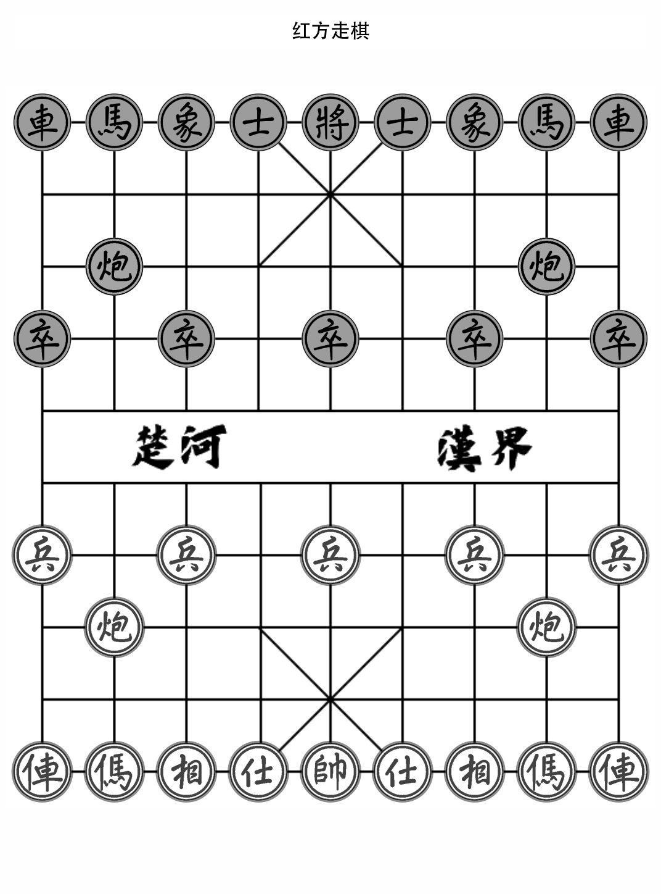
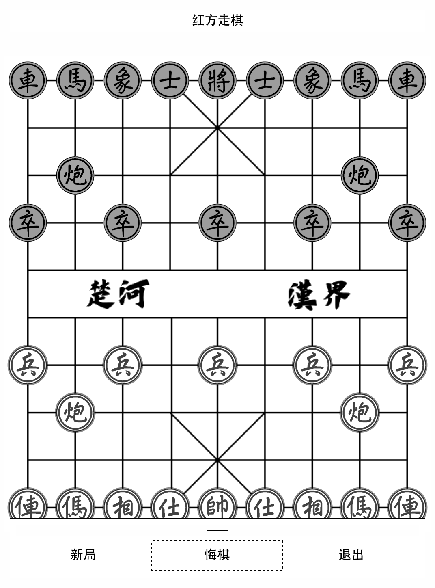

# Chinese Chess for Kindle

## PW4 focused UI / KPM adaptation

This branch targets PW4 firmware 5.18 with KPM. The playing screen contains
only the board and one status line. Swipe upward from the bottom edge to open
the floating menu, or tap the top/status area or bottom whitespace. Swipe
downward or tap the board to close it. The menu contains only New game,
Undo, and Exit; games save on exit and resume automatically on launch.
New-game settings use horizontal choices with pixel-sized labels. The library
entry starts quietly, and both sides use the complete 炮 character.

Install `xiangqi.kpkg` with KPM and open the `象棋` scriptlet in the library.
KUAL is not required. Detailed build, install, and verification steps are in
`docs/INSTALLING.md`. The upstream engine and piece artwork are preserved.

A Kindle-friendly Xiangqi / Chinese Chess app using the same native GTK2/Cairo
and KUAL packaging pattern as Kindle GlChess and Exact Reversi.

## Original upstream screenshot


## Features

- Touch-friendly 9x10 Xiangqi board with PNG board and piece artwork.
- Play Red, play Black, and two-player modes.
- Optional bundled Pikafish UCI engine support for stronger AI.
- Easy, medium, and hard built-in AI adapted from the GPL-3.0 XMuli
  ChineseChess project as fallback.
- Undo, automatic save on exit, and automatic resume on launch.
- KPM package with bundled ARM runtime libraries, Pikafish, and NNUE; no KUAL required.

## Pikafish

The release package can include a Kindle ARMv7 hard-float build of Pikafish for
stronger AI play. If Pikafish is unavailable or fails to start, the app falls
back to the embedded AI automatically.

For maintainers building from source:

```bash
git submodule update --init --recursive
./package_extension.sh
```

Detailed Pikafish ARM build notes are in
[docs/PIKAFISH_ARM32_BUILD.md](docs/PIKAFISH_ARM32_BUILD.md).

### Setting Up The Pikafish Submodule

For this repository, Pikafish is intended to live as a pinned Git submodule at
`Pikafish/`:

```bash
git submodule add https://github.com/official-pikafish/Pikafish Pikafish
git -C Pikafish checkout 76239d0b06720bfa4588989fd4ac7573e9dbf887
git add .gitmodules Pikafish
```

Future clones should use:

```bash
git clone --recurse-submodules <repo-url>
```

For an existing clone:

```bash
git submodule update --init --recursive
```

## Legacy KUAL build

```bash
git submodule update --init --recursive
./docker_rebuild.sh
./build_pikafish.sh
./package_extension.sh
```

The output package is:

```text
release/exact-chinesechess-extension.zip
```

Unzip it at the Kindle USB-storage root so it creates:

```text
/mnt/us/extensions/exact-chinesechess
/mnt/us/documents/shortcut_exactchinesechess.sh
```

Then launch from KUAL:

```text
KUAL -> Exact Chinese Chess -> Launch
```

## License And Provenance

Rules and built-in AI reference: XMuli ChineseChess, GPL-3.0-or-later,
<https://github.com/XMuli/ChineseChess>.

Artwork: Augus1217 Chinese-Chess, MIT per source project metadata,
<https://github.com/Augus1217/Chinese-Chess>.

Optional engine: Pikafish, GPLv3,
<https://github.com/official-pikafish/Pikafish>. When the release zip bundles
Pikafish, `LICENSES/PIKAFISH-SOURCE.txt` records the exact upstream commit and
build/source details.

## KPM 支持与专注对局界面

本分支基于上游 Kindle v0.1.3，调整触屏交互并增加 KPM 安装包。
最新安装版为 **[v0.2.2](https://github.com/videni/chinese-chess-for-kindle/releases/tag/v0.2.2)**。

### 界面调整

- 主界面保留大棋盘和当前走棋方；去掉标题、引擎信息、手数及棋谱入口。
- 底部白底工具栏只有“新局、悔棋、退出”，浮在棋盘上，展开和收起均不改变棋盘位置或大小。
- 底边上滑、轻点顶部状态或棋盘上下留白均可打开工具栏；点棋盘或向下滑动收起，本次触摸不落子。
- 顶边向下滑仍可打开 Kindle 原生快捷设置，系统顶部栏不常驻。
- 新局使用水平单选项，提供“我执红、我执黑、双人对弈”；双人模式隐藏电脑难度，取消保留原局。
- 退出自动保存，启动自动恢复；恢复提示两秒后切回当前走棋方。删除手动保存、载入和自动演示选项。
- 修复菜单开关时左上角的多余重绘，以及后台已有棋局时再次进入会退回首页的问题。
- 棋盘、状态和弹窗共用一个画布；弹窗开关只刷新面板区域，横条与按钮同次绘制，去掉分层窗口造成的分段刷新。
- 书库入口显示中国象棋封面，启动不再显示脚本输出中转页。

以下为此前拍摄的 PW4 真机截图；本版沿用此布局，改进了弹窗绘制方式：

 

### 直接安装

需要已越狱并安装 KPM 的 Kindle；书库入口需要 Hotfix 提供的 Scriptlet 支持。
安装包平台为 `kindlehf`（ARM32 hard-float），已在 **PW4 / 固件 5.18.1.1.1 / KPM 0.2.4** 上验证，其他机型尚未实测。

1. 从 [Release 页面](https://github.com/videni/chinese-chess-for-kindle/releases/tag/v0.2.2) 下载 **[xiangqi.kpkg](https://github.com/videni/chinese-chess-for-kindle/releases/download/v0.2.2/xiangqi.kpkg)**。
2. 将文件复制到 Kindle USB 存储根目录，文件名保持 `xiangqi.kpkg`，安全弹出设备。
3. 在 Kindle 首页搜索栏输入并执行：

```text
;kpm install file:///mnt/us/xiangqi.kpkg
```

4. 安装后打开书库里的“象棋”，也可执行：

```text
;kpm launch exactchinesechess
```

包内已包含应用、运行库、Pikafish 和 NNUE，无需自行编译或另外下载引擎，也不需要 KUAL。
本版通过 GitHub Release 下载文件安装，尚未上架 KPM 官方软件源。

更新前先从菜单退出，完成自动保存。若 KPM 0.2.4 覆盖安装提示
`Could not resolve dependency graph`，执行 `;kpm uninstall exactchinesechess` 后重新安装；
存档位于 `/mnt/us/exact-chinesechess/game.save`，卸载和重装均保留该目录。

Release 同时附带 `source.tar.gz`、`INSTALL.txt` 和 `SHA256SUMS`。
完整说明见 [安装与构建文档](docs/INSTALLING.md)。

刷新验证：GTK 集成测试要求菜单开关各触发一次面板区域重绘，且始终只有一个内容绘制窗口。PW4 实测已消除横条和按钮分段闪动；菜单开关仍会出现一次整块黑白反色，本版尚未做到无闪刷新。
